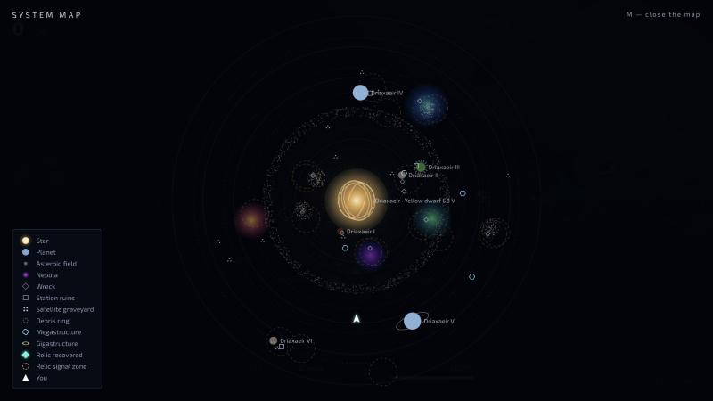
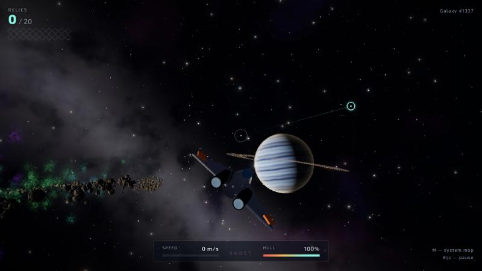

# Void Relics

A browser space-flight game on three.js: free mouse-steered flight through a procedurally
generated star system, hunting for twenty alien relics. The world, its textures, the music and
the sound are all generated at runtime from a single seed — the build contains no images and no
audio files.


| | |
|---|---|
|  |  |
|  |  |

## What is out there

- **A star** with a boiling surface and a corona. You can fly close, but inside ~1.9 radii the
  hull starts to heat up, and at the surface it burns through in seconds. The heat zone is
  marked on the map.
- **Six planets**: lava, desert or rocky, an Earth-like world with clouds and city lights, gas
  giants (often ringed), ice worlds.
- **An asteroid belt** and four **asteroid fields** — thousands of solid rocks of different
  shapes.
- **Four nebulae** — coloured smoke that cuts visibility, halves the scanner range and now and
  then flashes with lightning.
- **Derelict wrecks** — torn hulls with flickering windows, sparks and a cloud of debris.
- **Station ruins** — a broken truss station with modules and solar wings, or a torn habitat
  wheel, drifting apart in slow tumbles; some portholes and beacons still have power.
- **Satellite graveyards** — clusters of dead satellites (gold foil, solar wings, dishes)
  tumbling among loose panels, and a **debris ring** of junk around the Earth-like world that
  glints from orbit.
- **20 relics**: in the fields, in the belt, inside nebulae, by the wrecks, in planetary orbits,
  in deep space, and one dangerously close to the star.

## How to play

| Key | Action |
|---|---|
| Mouse | Steer: the nose follows the cursor; the further from the centre, the sharper the turn |
| W | Thrust. Let go and the ship stops |
| S | Brake / reverse |
| Space | Boost |
| A / D | Strafe |
| Q / E | Roll |
| M (or Tab) | System map |
| Esc | Pause |

A relic shows from far away as a faint pulsing point of light, and the scanner picks up its
signal within ~6.5 km (half that inside a nebula). On the map, every missing relic is drawn as a
circle it lies somewhere inside. Progress is saved in the browser.

`?seed=12345` in the URL gives a different galaxy; the **New galaxy** button does the same with a
random number.

## Run it

```bash
npm install
npm run dev      # http://localhost:5173
npm run verify   # typecheck + tests
npm run build    # static site in dist/
```

Needs Node 24 (`.nvmrc`) and a browser with WebGL 2.

## Publishing to GitHub Pages

`.github/workflows/deploy.yml` builds and publishes the site on every push to `main`. On the
free GitHub plan, Pages only serves public repositories, so while this repository is private the
deploy is skipped. To switch it on: make the repository public and set Settings → Pages →
Source to **GitHub Actions**.

## How it works

- `src/world/generate.ts` — the whole system as data from the seed: orbits, belt, fields,
  nebulae, wrecks, relics, spawn point, stations, satellite graveyards and the junk ring.
  Covered by tests (determinism, exactly 20 relics, none inside a planet or a rock, debris
  clear of everything, old galaxies unchanged by new content, and so on).
- `src/game/flight.ts` — the arcade flight model: thrust → cruise speed, no thrust → stop,
  boost, turning toward the cursor.
- `src/render/` — shaders for the planets, the star and the sky; nebula smoke from a baked
  noise texture; asteroids from displaced icospheres; procedural wrecks, stations, satellites
  and junk, and the player ship.
- `src/audio/engine.ts` — generative ambient on Web Audio: slow chords in drifting modes, FM
  bells with echo, a drone, cosmic wind, a tension layer near the star; plus engine, impact,
  scanner ping, pickup and explosion sounds.

Development notes are in [AGENTS.md](AGENTS.md).
