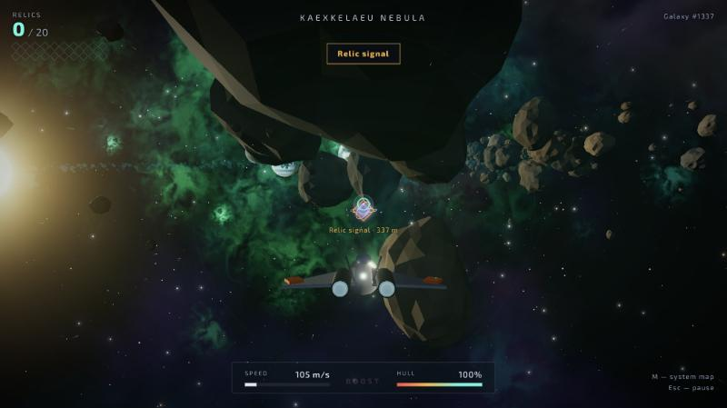
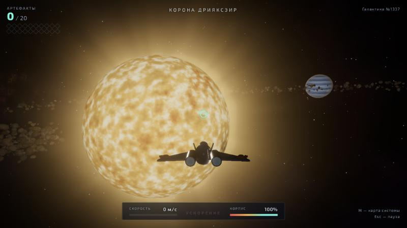
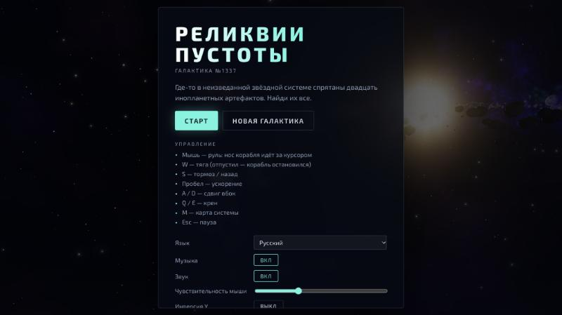

# Void Relics

A browser space-flight game on three.js: free mouse-steered (or, on a phone, thumb-steered)
flight through a procedurally generated star system, hunting for twenty alien relics. The
world, its textures, the music and the sound are all generated at runtime from a single seed —
the build contains no images (beyond the app icons, which a script draws) and no audio files.

**▶ Play it in the browser: [filioink.github.io/void-relics](https://filioink.github.io/void-relics/)**



| | |
|---|---|
|  |  |
|  |  |

## What is out there

- **A star** with a boiling surface and a corona, of a real class that differs from galaxy to
  galaxy: a red, orange or yellow dwarf, a yellow-white F or white A star, or a white dwarf a
  few hundred metres across, each with its temperature, size and luminosity from the reference
  tables (see Infinite flight below). Its class sets its colour, size, brightness and the light
  it casts; the map and the HUD name it. The default galaxy (the title screen and a first
  launch) keeps the golden sun it has always had. You can fly close, but inside ~1.9 radii the hull
  starts to heat up, and at the surface it burns through in seconds. The heat zone is marked on
  the map.
- **Six planets**: lava, desert or rocky, an Earth-like world with clouds and city lights, gas
  giants (often ringed), ice worlds.
- **An asteroid belt** and four **asteroid fields** — thousands of solid rocks of different
  shapes.
- **Four nebulae** — coloured smoke that cuts visibility, halves the scanner range and now and
  then flashes with lightning.
- **Derelict wrecks** — torn hulls with flickering windows, sparks and a cloud of debris.
- **Station ruins** — a broken truss station with modules and solar wings, or a torn habitat
  wheel, drifting apart in slow tumbles; some portholes and beacons still have power.
- **Satellite graveyards** — clusters of dead satellites (gold foil, solar wings, dishes)
  tumbling among loose panels, and a **debris ring** of junk around the Earth-like world that
  glints from orbit.
- **Megastructures**, about two per galaxy: a **ring gate** you can fly through, an **O'Neill
  habitat** (a cylinder with window strips, opened mirrors and a turning ring of greenhouses),
  or a patch of a **Dyson lattice** — hexagonal collectors curving around the star. They are
  solid, on the map as hexagons, and named in the location banner.
- **A gigastructure** in about a third of galaxies: **Dyson rings** — tilted rings of
  collectors wrapped around the star — or a **ringworld**, a band of land and sea 150 km
  across circling the whole system past its edge, rim walls on both sides. You can fly to it
  and skim its land.
- **20 relics**: in the fields, in the belt, inside nebulae, by the wrecks, in planetary orbits,
  in deep space, and one dangerously close to the star.

## How to play

| Key | Action |
|---|---|
| Mouse | Steer: the nose follows the cursor; the further from the centre, the sharper the turn |
| W | Thrust. Let go and the ship stops |
| S | Brake / reverse |
| Space | Boost |
| Left mouse / F | Fire lasers |
| A / D | Strafe |
| Q / E | Roll |
| M (or Tab) | System map |
| Esc | Pause. The pause card also has **Main menu**: back to the start screen, the hunt kept as it is |

**On a phone or tablet** the game shows touch controls instead. Drag anywhere on the left half
of the screen to steer: a stick appears under the thumb. On the right, around the thumb, are
**Thrust** (hold it, or tap it once to keep flying; press it again to brake, and hold it to
reverse), **Boost** and **Fire**; the system map and pause are in the top-right corner (pause
also leads to the main menu). Steering, thrust and fire work at the same time. Portrait and
landscape both work. In infinite flight, a tap brings up the camera, music, full-screen and back
buttons.

A relic shows from far away as a faint pulsing point of light, and the scanner picks up its
signal within ~6.5 km (half that inside a nebula). On the map, every missing relic is drawn as a
circle it lies somewhere inside. Progress is saved in the browser.

**Lasers.** Twin wing guns fire red bolts at eight shots a second; hold too long and they
overheat and lock until they cool. The red cross ahead of the nose is where both barrels meet.
Smaller rocks (up to ~140 m), satellites and loose junk break apart under fire — the
mountains and station hulls do not. Some of them hold **salvage** (void crystals, data cores)
that drifts out and flies to the ship. The relics in asteroid fields and by the wrecks are
**sealed in rock**: the scanner finds them, but you have to shoot the shell open first. What
you break stays broken.

`?seed=12345` in the URL gives a different galaxy; the **New galaxy** button does the same with a
random number. `?perf=1` shows frame rate, frame / CPU / GPU time and draw-call counts in the
corner.

## Infinite flight

**Infinite flight** in the menu is a screensaver of a mode: the ship flies itself down an endless
path while asteroid fields, nebulae, planets (some ringed, some with a moon), stars, station
ruins and satellite graveyards are generated ahead of it and dropped behind. The autopilot
slows through fields and ruins, opens up across empty space, and in fields picks off a rock now
and then.

**Megastructures** fill one 6 km stretch in ten: a **ring gate** the path flies through, an
**O'Neill habitat** — a cylinder with window strips, opened mirrors and a turning ring of
greenhouses — beside it, or a torn patch of a **Dyson lattice** of hexagonal collectors curving
overhead. **Gigastructures** fill one stretch in fifty: a **ringworld** whose band of land and
sea arches across the sky some 25 km overhead, its star far below, or **Dyson rings** around a
star some 35 km off, each with a star of its own class. They fade in long before you reach
them and stay a while after. The autopilot slows down to take either in. Stars and planets
still pass next to a megastructure; a gigastructure keeps its stretch and the ones beside it
to itself. Whatever would touch a mega- or gigastructure gives way to it.

**The chances** are `MEGA_CHANCE` (10%) and `GIGA_CHANCE` (2%) in
`src/world/megastructures.ts`. Every infinite-flight stretch rolls for each on its own; a star
system has `SYSTEM_SITES` (20) sites that roll the same way, at most one gigastructure each.
`?mega=<percent>` and `?giga=<percent>` in the URL override them in both modes (`?mega=100`
puts a megastructure in every stretch after the first three, `?giga=100` as many
gigastructures as fit; `?giga=0` turns them off). The camera cuts between a chase view, a slow orbit around the ship, a wide shot and the
cockpit — every one rides with the ship, none waits in space for it to fly past. The only things on screen are the name of each new place as it fades in and two small
buttons in the bottom-right corner: a note that switches the music off and on (or **M**; it is
the same setting as Music in the menu) and full screen (or **F**). The buttons and the cursor
fade out while the mouse rests. **C** changes the camera, **H** hides the place names, **Esc**
goes back to the menu; on a touch screen, buttons do the camera and the way back. The journey
is fixed by the galaxy seed.

**Every star is a real kind of star.** Each one is drawn as a class — a main-sequence O, B, A,
F, G, K or M star, a red giant, a red supergiant, a blue supergiant or a white dwarf — and gets
its temperature and radius from published values for that class (Mamajek's dwarf sequence,
Levesque et al. 2005 for red supergiants), with the luminosity from the Stefan–Boltzmann law.
The temperature sets its colour (Planck's law through the CIE 1931 observer), its brightness,
its corona and the colour of the light it throws on the ship and planets; the radius sets its
size, squeezed so that a white dwarf is a dazzling few hundred metres and a red supergiant a
wall of fire tens of kilometres across, seen from well over a hundred. A star's name comes with
a line of its facts: "Red supergiant · M3 I · 3,580 K · 401 solar radii". Stars fade in and out
as their stretch of the path is loaded and dropped.

**Full screen keeps the screen on.** While the game is full screen, or opened as the installed
app, it holds a screen wake lock, so a phone left to infinite flight does not dim and lock.
Where the browser has no Wake Lock API (Firefox before 126, iOS before 16.4) the screen dims as
usual.

## Install it as an app

**Install app** under the menu's buttons installs the game as an app (a PWA) on a phone or a
computer: its own icon, its own window (full screen on a phone), and it plays without a
connection. In Chrome, Edge and Samsung Internet the browser's own install dialog opens; on an
iPhone or iPad a card shows the Share → Add to Home Screen steps, in Safari on a Mac File → Add
to Dock, and in any other browser where its menu has the install item. The item is not shown
inside the installed app, and leaves the menu once the browser reports the install.

## Run it

```bash
npm install
npm run dev      # http://localhost:5173
npm run verify   # typecheck + tests
npm run build    # static site in dist/
npm run preview  # serve dist/ — the only way to see the service worker and installing
```

Needs Node 24 (`.nvmrc`) and a browser with WebGL 2.

## Publishing to GitHub Pages

`.github/workflows/deploy.yml` builds and publishes the site on every push to `main`, and it is
live at <https://filioink.github.io/void-relics/>. On the free GitHub plan, Pages only serves
public repositories, so the deploy job skips itself if the repository is ever made private
again.

## How it works

- `src/world/generate.ts` — the whole system as data from the seed: orbits, belt, fields,
  nebulae, wrecks, relics, spawn point, stations, satellite graveyards and the junk ring.
  Covered by tests (determinism, exactly 20 relics, none inside a planet or a rock, debris
  clear of everything, old galaxies unchanged by new content, and so on).
- `src/game/flight.ts` — the arcade flight model: thrust → cruise speed, no thrust → stop,
  boost, turning toward the cursor.
- `src/render/` — shaders for the planets, the star and the sky; nebula smoke from a baked
  noise texture; asteroids from displaced icospheres; procedural wrecks, stations, satellites
  and junk; the player ship in plating painted at start-up (`plating.ts`: panel seams, rivets,
  wear, a normal map from the same layout), with a framed canopy, wing cannons and belled
  nozzles.
- `src/audio/engine.ts` — generative ambient on Web Audio: slow chords in drifting modes, FM
  bells with echo, a drone, cosmic wind, a tension layer near the star; plus impact, scanner
  ping, pickup and explosion sounds. Music plays at 90% by default (Music volume under Settings in the menu).
- `src/audio/rocketVoice.ts` — the rocket engine: no tone, only noise — a brown-noise rumble,
  a pink-noise roar, exhaust crackle, combustion flutter and soft saturation, plus a whump on
  ignition and boost and a chuff on cut-off.

Development notes are in [AGENTS.md](AGENTS.md).
