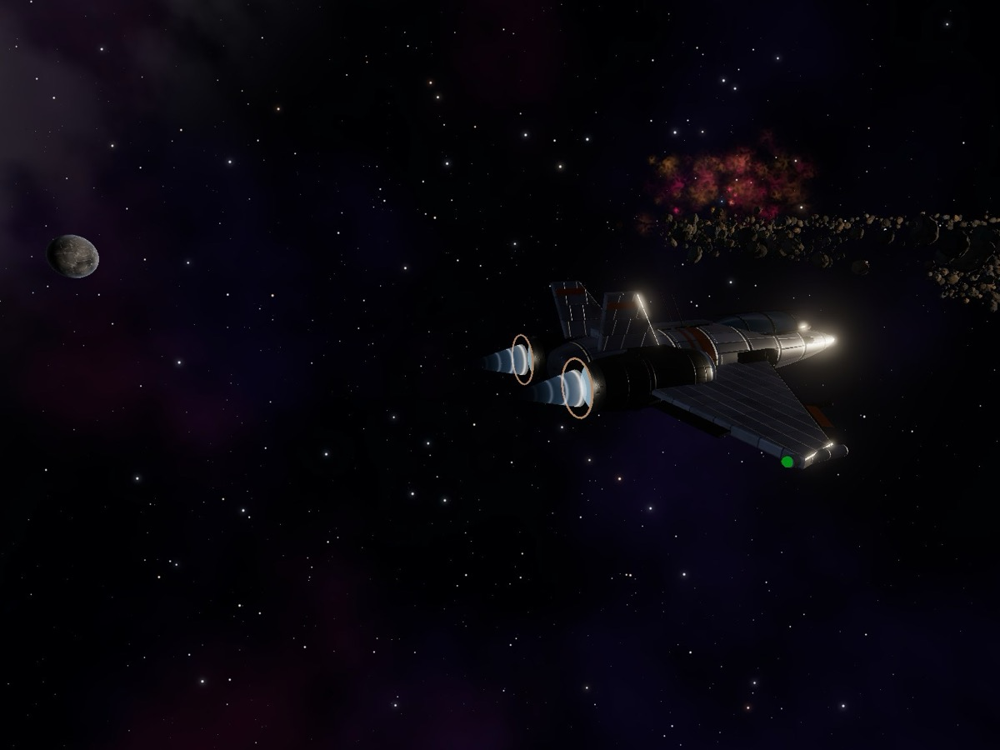
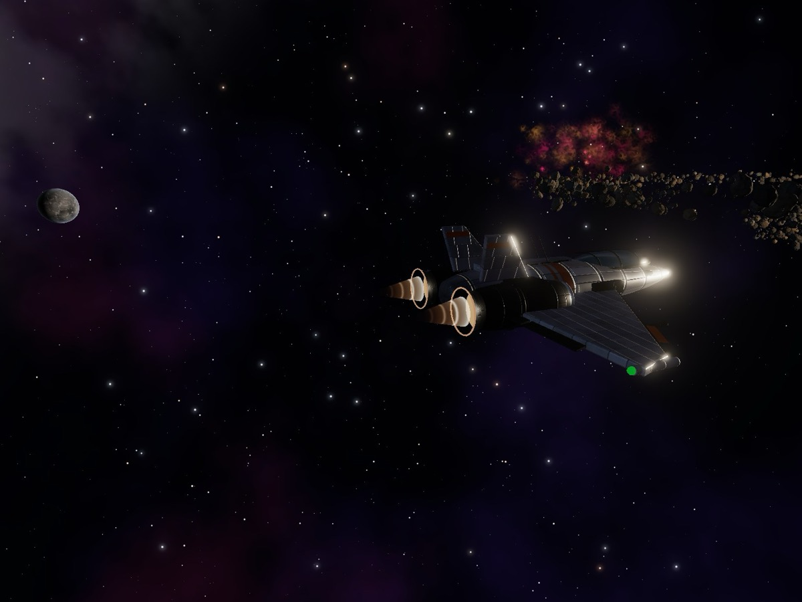
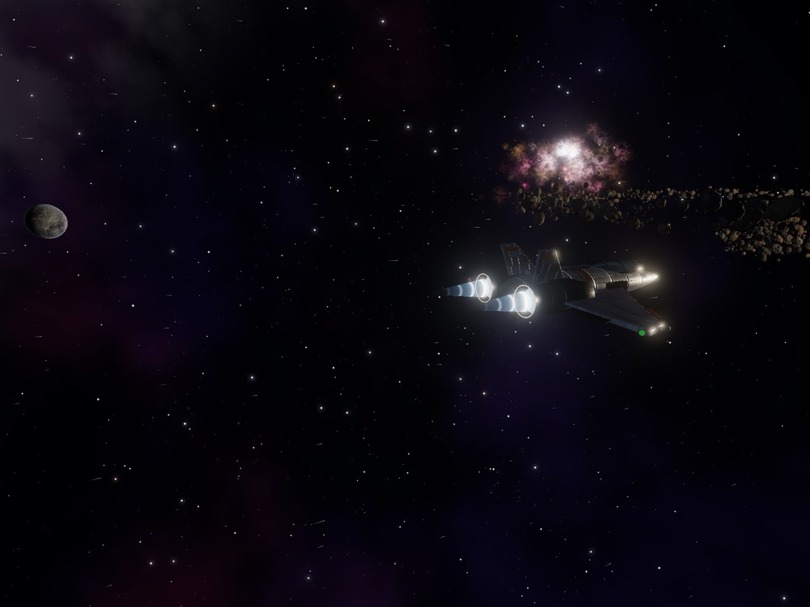
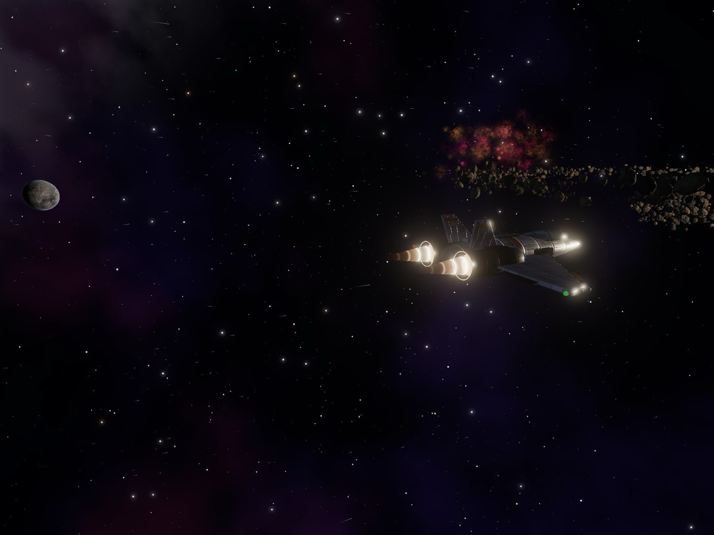
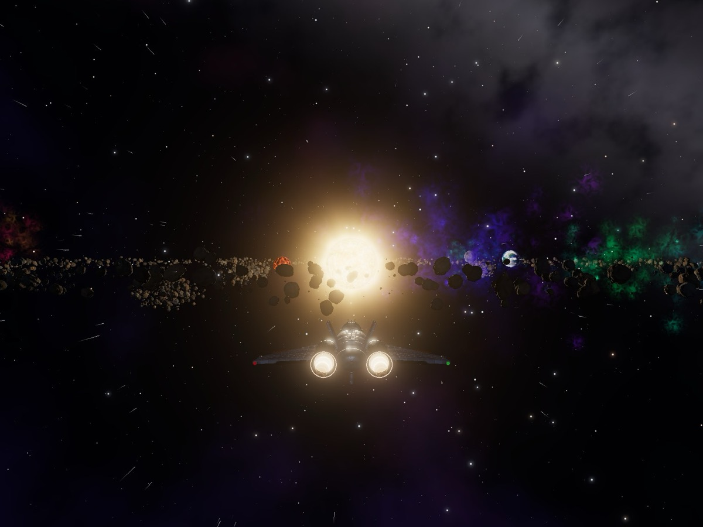

# Engine flame — design QA

The owner's note: the flame and the engines' colour should read white-orange, not blue.
Checked in the built-in browser, galaxy 1337, at the `spawn` benchmark spot under full thrust
and then boost; the camera was pinned to the same spot behind the ship's right shoulder for
before and after.

| | |
|---|---|
| Before, thrust |  |
| After, thrust |  |
| Before, boost |  |
| After, boost |  |
| After, chase camera, thrust |  |

What changed and what to look for:

- **Flame.** Was a short white knot fading to sky blue, with a magenta tint on boost. Now
  white-hot at the nozzle, orange through the body and a deep ember red at the tail. The shock
  diamonds still flash towards white.
- **Boost.** No magenta any more: boost pushes the white core further down the plume, so a
  boosted flame is longer and whiter rather than a different hue.
- **Nozzle throat.** The disc inside the bell glowed pale blue; now warm orange-white, so from
  the chase camera the engines read as two warm-white discs with an orange halo.
- **Unchanged.** The bell rim (already dull red heating to white), flame length and shape, the
  HUD's pink BOOST tag.
