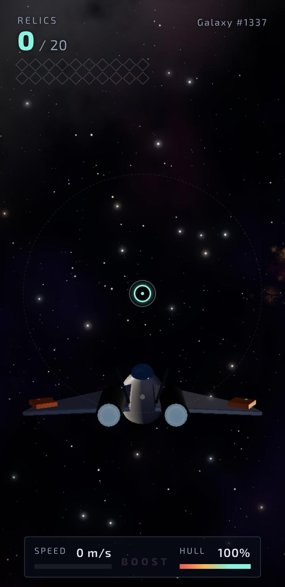
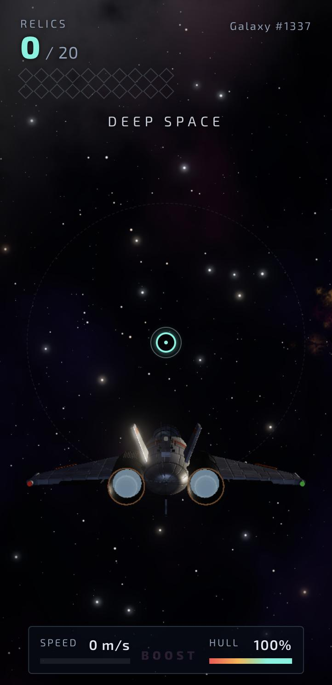
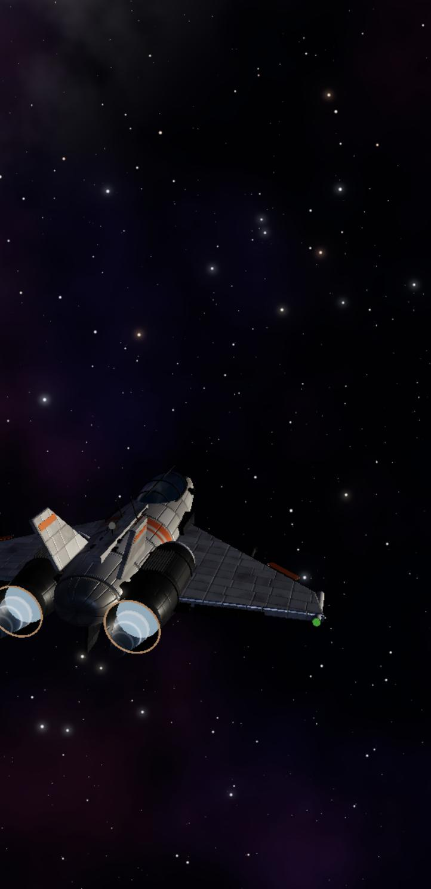
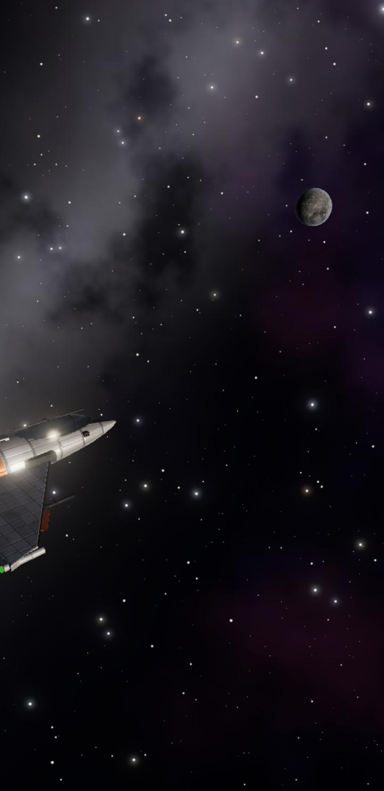
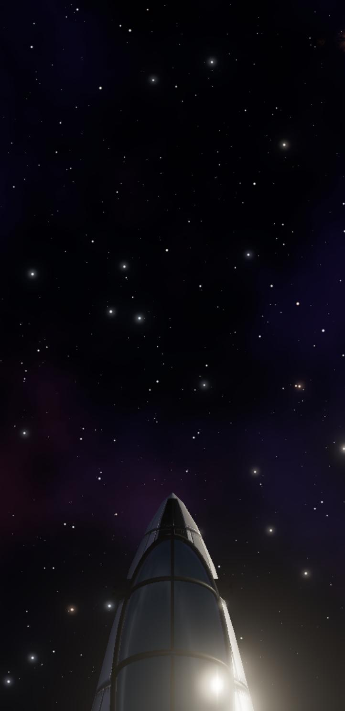

# Ship detail — design QA

The owner's note: the ship looked toy-like. Checked in the built-in browser, galaxy 1337, at
the spawn point turned so the star lights the ship from the right; same spot and camera for
before and after.

| | |
|---|---|
| Before, chase camera |  |
| After, chase camera |  |
| After, rear three-quarter |  |
| After, side (cannon under the wing, canopy frame) |  |
| After, canopy from above (frame, anti-glare panel) |  |

What changed and what to look for:

- **Skin.** Plain grey metal → painted plating: panels in slightly different tones, recessed
  seams and rivets (from a normal map baked off the same layout), scratches and grime, a darker,
  rougher finish where the grime is. The fuselage has its own skin: orange bands behind the
  cockpit, a matt anti-glare panel ahead of it, the hull number on the flanks, soot over the tail.
- **Shape.** 48-segment fuselage (was 20) with a dorsal spine and belly keel; a framed canopy
  (three arches, a sill, a centre strip) in clear-coated glass; wings with a leading edge, flaps,
  a wingtip fairing and an orange stripe; a cannon under each wing; canted fins with a stripe and
  a ventral fin; intake scoops; RCS blocks; antennas and greebles along the spine.
- **Engines.** Nacelles with an intake lip, fan face and spinner, two bands, a finned radiator
  on top, and a belled nozzle whose rim heats from dull red to near white with the burn. The
  flame shows shock diamonds that sharpen with power.
- **Gone.** The orange boxes on the wingtips.
- **Unchanged.** Size, `SHIP_RADIUS`, the `ShipView` API, the camera.

Cost: 17 → 13 draw calls for the ship (static parts are merged per material). Textures are
painted once at start-up: one 1024×512 skin and two 512×512 tiling skins, each with a colour,
normal and roughness map.

Not checked: the hull number up close (at the chase camera's distance it is a few pixels), and
the ship on a real screen at full frame rate — the browser pane here was throttled.
